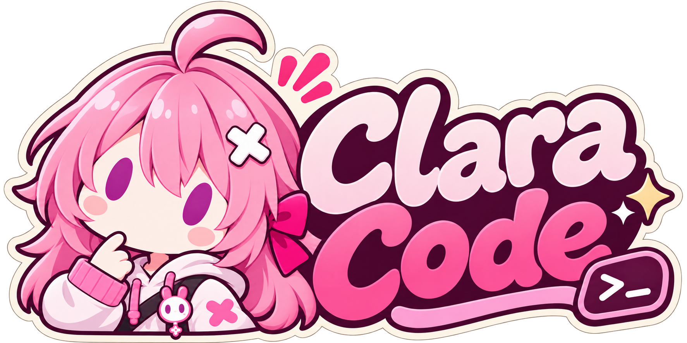

# Clara Code



Clara Code is a terminal coding assistant. Use it to explore a codebase, plan changes, and implement them while keeping the conversation in your terminal's native scrollback.

## Installation

Download and extract a [GitHub release](https://github.com/ClarkQAQ/clara-code/releases) for Linux, macOS, or Windows. See the [installation guide](docs/installation.md) for supported architectures, checksums, Forgejo packages, and source builds with Go 1.27.

## Quick start

From the directory containing the executable, try the demo without a model account or open a project.

```sh
./clara-code --demo
./clara-code --cwd /path/to/project
```

In Windows PowerShell, use `.\clara-code.exe` and a Windows project path, such as `C:\Projects\Example`.

On a fresh install, the setup guide asks for your provider's API base URL, protocol, model ID, and an API key if required. Once the composer opens, type a request and press Enter. Use `/help` to see the available commands.

[Usage guide](docs/usage.md) · [Configuration](docs/configuration.md) · [ACP integration](docs/acp.md) · [Go packages](docs/core.md) · [Development](docs/development.md)
