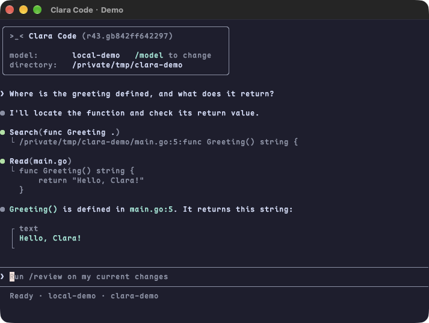

# Using Clara Code

## Commands and shortcuts

Type `/` to open the two-column command menu. Use Up/Down to select, Tab to complete, Enter to confirm, or Esc to close the menu and keep the draft.

| Action | Key or command |
| --- | --- |
| Submit input or steer an active turn | Enter |
| Insert a newline | Shift+Enter in terminals that support extended keys, or Alt+Enter / Ctrl+J |
| Switch between Agent and Plan | Shift+Tab, or `/agent` and `/plan` |
| Interrupt a turn | Esc or `/cancel` |
| View or stop background terminals, including during a turn | `/ps` or `/stop [ID]`. Omit the ID to stop all terminals present when called. |
| Edit a previous message and create a branch | Press Esc twice with empty input. Use Left/Right to select, Up/Down to scroll, Ctrl+T to toggle details, and Enter to confirm. |
| Create, resume, or fork a conversation | `/new`, `/resume [ID]`, or `/fork` |
| Clear the terminal and start a new conversation | `/clear`. The old session remains resumable. |
| View usage, configuration, or the working directory | `/status` or `/pwd` |
| View changes | `/diff`. Use Tab to switch staged, unstaged, and untracked views, and n/p to change pages. |
| Attach or manage images | Ctrl+V, `/attach <path>`, or Ctrl+G. Delete removes a selected attachment. |
| Select a model and reasoning effort | `/model [name [effort]]` |
| Review current Git changes without writing | `/review` |
| Compact model context manually | `/compact` |
| Run a goal or queue follow-up instructions | `/goal`, `/pause`, `/continue`, or `/follow` |
| View connections or manage skills | `/mcp` or `/skills` |
| Show help or exit | `/help`, `/exit`, or `/quit` |

## Terminal behavior

Clara uses the terminal's main screen and keeps completed conversations in native scrollback. When the window resizes, Clara rebuilds the terminal buffer from logical messages so the conversation, current question, menu, and draft all reflow.

Clara requests the Kitty keyboard protocol in compatible terminals. In tmux, Shift+Enter requires `set -s extended-keys on` and a terminal that can report extended keys.

The composer, question notes, and free-text answers use the real terminal cursor, so Chinese IME candidates and input-mode indicators can follow the insertion point. The cursor keeps the terminal's default shape, hides in read-only selectors, and reappears on exit. Clara measures cursor positions in terminal display columns for Chinese text, combined emoji, multiline input, and narrow windows. The terminal and system IME control candidate appearance and selection.

The terminal title shows the project name, with a spinner during requests and an `Action Required` prefix while Clara waits for an answer. In VS Code, set `terminal.integrated.tabs.title` to `${sequence}` if the tab only shows the process name.

### Progress and tool output

Clara stores progress updates and final answers separately. A tool call appears as an updating record such as `● Bash(command)`, with output beneath `└`. Green indicates success and red indicates failure. Cancellation and background execution have their own states. Shell results report the actual exit code, and later background output updates the original record. Long previews retain the beginning and end. Records follow session storage limits and replay when you resume or resize.

A successful turn that takes more than 60 whole seconds displays a line such as `Worked for 1m 01s` after the reply. Automatic and manual compaction display their own elapsed time, for example `Context compacted · 8s`. These lines remain visible when you resume the conversation.

The activity line above the composer shows waiting, execution, compaction, or reconnection, with elapsed time and the Esc interruption hint. Interactive questions temporarily hide it. The reasoning content shown in progress updates comes from public summaries, which can supply an activity title. Core retries eligible connection-establishment errors up to three times and shows the attempt, delay, and redacted reason. Interruptions after streaming starts preserve received text and report the error without automatically replaying executed tools. You can retry with the current draft after a failure. An empty composer is refilled with the failed turn's prompt.

## Agent and Plan modes

Switch modes with Shift+Tab, `/agent`, or `/plan`. Plan mode appears on the right of the status bar. A completed proposal appears in a **Proposed Plan** card. Use Up/Down and Enter, or press 1–3, to start implementing in the current conversation, start a fresh Agent conversation with the approved plan, or stay in Plan mode to refine it. Esc dismisses the choices and stays in Plan mode. A fresh conversation keeps the original plan available through `/resume`.

In Agent mode, file tools and Shell use the current user's OS permissions and can reach outside the project. Plan mode offers read-only and interaction tools plus Shell for diagnostics, tests, and builds that preserve tracked files and task-relevant state. Plan instructions restrict command use. The Shell process itself still runs with the current user's OS permissions.

## Model and reasoning selection

`/model` selects a provider and model, then shows separate Agent and Plan reasoning pickers with numbered choices, explanations, and `(default)` and `(current)` markers. Plan can inherit the staged Agent level. Final confirmation saves both values to the session and retains the current model context and global settings. Esc goes back so you can revise your choices before saving. See [Configuration](configuration.md) for provider settings and model catalogs.

## Interactive questions

Interactive questions have numbered choices and descriptions. Use Up/Down or number keys to select, Tab to edit notes, Left/Right to switch questions, Enter to submit, and Esc to interrupt.

## Skills

Type `$` at a word boundary to open the skill menu and enter text to filter names or descriptions. Use Up/Down to select and Enter or Tab to insert `$skill-name` into the draft. Esc closes the menu. Shell expansions such as `$HOME` and `${HOME}` stay ordinary text. Skill references are highlighted and edited as a unit. Left/Right crosses the whole reference and Backspace/Delete removes it. Restored drafts recover known references with their original text, surrounding content, and image attachments. The model loads selected skills and supporting text files with `read_skill` and `read_skill_resource`.

In `/skills`, **List skills** opens the same menu and **Enable/Disable Skills** opens a searchable checkbox list. Use Up/Down to select, Space or Enter to toggle, and Esc to go back. Changes save to `skills-state.json` in the Clara data directory using atomic saves and a process lock. Clara keeps configuration and skill definitions as written. Preferences follow canonical `SKILL.md` paths, so disabling a project skill affects that definition only. The nearest definition still takes precedence when disabled. Disabled skills disappear from completion, model catalogs, and catalog-reading tools on the next request for main agents, subagents, and ACP. Re-enabling restores them. Use this setting to control discovery. Filesystem access to skill files follows the usual tool permissions.

See [Rules and skills](configuration.md#rules-and-skills) for global and project skill locations.

## Images

Ctrl+V reads an image from the system clipboard in the background and falls back to clipboard text. Ordinary terminal paste uses bracketed paste. macOS uses AppKit through the system JavaScript bridge. Linux uses `wl-paste` on Wayland or `xclip` on X11. Windows reads Unicode text and PNG or bitmap images from the system clipboard. If Windows Terminal handles Ctrl+V itself, change its paste binding to let Clara receive that shortcut. Clipboard reads have a four-second timeout and bounded output. Clara reports missing helpers without installing them. `/attach PATH` works independently of the clipboard.

Paste or drag complete local image paths, including quoted or escaped spaces, multiple paths, and `file://` URLs. Paths inside an ordinary sentence remain text. `/attach <path>` adds an image explicitly. Invalid paths retain the pasted draft and report the failure. Attachments appear inline as cyan `[Image #1]` markers at the insertion point. Text is editable on both sides of each marker. Left/Right crosses the entire marker and Backspace/Delete removes the attachment. Numbering follows display order. Ctrl+G opens a selector with filenames and dimensions for managing attachments. You can submit images alone or with text, steer an active turn with them, or include them in `/follow`. Unaccepted and failed submissions retain text and attachments.

By default, each submission allows any number of images and any combined normalized size. Configure positive limits with `[images].max_attachments` and `max_total_bytes`. Omit a limit or use `0` or `-1` to disable it. Clara shrinks decoded images to fit `max_pixels` and `max_dimension`, which default to 64 million pixels and a 2048-pixel longest side. The default source size limit is 16 MiB per image and the decoder accepts up to 64 million source pixels.

A model without image support rejects new attachments and blocks submissions with images in the draft. You can still switch to that model with images in your history. Its requests replace historical images, including file and MCP tool images, with an omission notice. Switching back to an image-capable model restores image input from the original history. `image_view` is available only with image-capable models. The same policy applies to main agents, subagents, Plan, Review, and ACP.

Clara stores normalized images by content hash under `attachments/` in the application data directory. SQLite checkpoints and transcripts store attachment references. Recovery, forks, and prompt rewind use the stored copies. Missing or corrupt blobs produce explicit errors. Clara reconstructs standard model media parts for requests. Public Go packages use these media parts independently of the storage layout. Compaction uses image descriptions and findings while retaining original transcript attachments for replay and branching. For a file-copy backup, exit all Clara processes first, then copy `sessions.sqlite3` and `attachments/` together.

## Sessions and input history

Run `clara-code resume --cwd /path/to/project` to reopen a conversation from a terminal. Inside Clara, use `/resume [ID]`. `/fork` and editing an earlier message create a separate conversation and insert a `Forked from …` divider between inherited history and new messages. When editing an earlier prompt, Clara restores model context from before that prompt. Existing file changes and command effects remain in the workspace.

Clara stores sessions and turns in `sessions.sqlite3` in the data directory. A blank conversation stays in memory until its first message starts a turn. Clara applies bundled schema migrations when it opens the database. Legacy JSON files under `sessions/` and `turns/` stay on disk. Session discovery and resume use the SQLite database. Each session has its own lock, so separate processes can open different sessions in the same project. Closing a session ends its running goals, subagents, and Shell processes.

Submitted prompts and slash commands are saved in `history.jsonl` in the data directory and loaded on startup for Up/Down recall across conversations. Menu commands record their canonical form, such as `/status` for `/sta`. Clara collapses consecutive identical inputs and omits `/clear`. Each JSONL record contains `session_id`, an RFC3339 `ts`, `text`, kind, and optional attachment references. The file uses private permissions, process locking, and atomic replacement. It retains up to 1000 entries and 4 MiB. Clara reports malformed records and still loads valid ones. Command dispatch and drafts survive history write failures.

Input recall works independently of terminal scrollback, saved model turns, and the Esc-Esc conversation preview. Slash command history stays separate from model messages and rewind checkpoints. Recalled images and available skill mentions return to the composer. Recalling a slash command stays in Up/Down history navigation until you edit it to bring up the command menu.

## Background commands

Background terminals belong to their Clara session, including commands that subagents start. `yield_time_ms` controls how many milliseconds an initial execution or subsequent wait blocks before returning. The TOML setting `[tools.exec_command].yield_seconds` uses seconds. By default, commands run without a total runtime limit when `timeout_seconds` is omitted. Explicit timeouts apply up to 600 seconds. Esc interrupts the current agent turn and wait. Detached terminals keep running until you stop them with `/stop`, the session closes or switches, or the process exits.

When a background command is running, the area above the composer shows a line such as `1 background terminal running · /ps to view · /stop to close`, which merges into the activity indicator when shown. Clara checks status every 500 ms without consuming output and refreshes the UI when status or output changes. `/ps` leaves unread output available to the model. A model poll with empty input produces a separate `Waiting for background terminal` record that becomes `Waited for background terminal`. Sending input produces `Interacted with background terminal`. The original Bash record still shows output and final status. Canceling an input write stops waiting. The process may already have received input.

Asynchronous command states are saved separately from completed turns using atomic writes. Natural exits, failures, stops, and timeouts update the original command record. Unread output stays available through `write_stdin`. The completion cache retains up to 32 recent terminals and 1 MiB of output per terminal, with head-and-tail previews. Recovery and branching replay records without restarting processes. Old records without a final state appear as interrupted. Custom execution backends without Core's `SnapshotProcess` update only when the model polls explicitly, and `/ps` reports this limitation.

### Windows shell selection

The local command tool looks for PowerShell 7 on PATH, then Windows PowerShell 5.1, then Command Prompt. Clara reports the selected shell to the model. The shell that launched Clara can differ from the tool's shell. With the Command Prompt fallback, choose a drive-backed working directory. For stdio ACP and MCP, configure the server executable and arguments directly. A batch shim can be invoked through an explicitly configured `cmd.exe`.

## Files and Git

File tools and Shell use host paths. Relative paths start at the current working directory, `..` can access adjacent directories, `/` is the system root, and `~/` expands to the current user's home. File tools return absolute paths, including in Hashline headers. Shell `workdir` follows the same rules and can point outside the project. Reads, overwrite writes, and edits follow symbolic links. Moving or deleting a link operates on the link itself. Creating a file requires a path free of existing files and links.

Clara reads local Git repositories with go-git for `/diff`, `/review`, the branch indicator, and search filters. These features work without the Git executable or cgo. Staged and unstaged patches show a notice in place of text larger than 1 MiB per file.

By default, `glob` and `grep` use Git metadata to search tracked and unignored untracked files, including tracked files that match ignore rules. Set `include_ignored=true` to include ignored files. Recursive searches skip Git metadata and submodules unless explicitly selected as the search root. Searches use the target repository's rules, refreshed on each search. Direct `read` calls access the selected path independently. Non-Git projects search the full directory tree. Git enumeration failures are reported explicitly. Narrow the search path when enumeration exceeds 20,000 candidate files or 8 MiB of candidate path names.

Glob patterns support `*.go`, `**/*.go`, `?`, and character classes. `**` can match zero directory levels. `grep` searches literal text with `query` and filters files with `include`. For example, `{"path":"internal","query":"cursorPosition","include":["*.go"]}` searches for `cursorPosition` in Go files under `internal`. If a search is incomplete, inspect its diagnostics and narrow the scope. `fs_instructions` queries project rules. The host supplies global rules separately.

## Local time and timestamps

The UI formats local date-times using `time.DateTime` (`YYYY-MM-DD HH:mm:ss`) and dates as `YYYY-MM-DD`. `/status` shows the local time and time zone, as determined by the process's system settings and `TZ`. If the region name is unavailable, the UI shows the UTC offset. Main agents, subagents, Plan, Review, and ACP receive the local date and time zone in a compact environment block. Clara checks them every step and sends updates when they change. The model uses the latest values for relative dates. Elapsed seconds and precise per-message send times are absent from the model context. The environment stays in the model-window checkpoint, separate from raw conversation and terminal replay. Compaction preserves the original meaning of historical dates and time zones.

Session, event, and background-terminal metadata use RFC3339 JSON timestamps with `Z` or an explicit offset and retain fractional precision. Clara preserves older records and session and terminal IDs. The time fragments in those IDs are identifiers. `stat.modified` uses RFC3339Nano. ACP logs include time zones and go only to standard error. Elapsed times and timeouts use durations. Formats such as PDF retain their own date specifications.

## MCP connections

While opening a conversation, Clara shows the MCP server currently connecting and the number of completed attempts. If an optional connection fails, Clara opens the session and prints one warning with the affected servers and their errors. A failure for a server with `required = true` prevents the session from opening. `/mcp` lists enabled servers, their connection results, and tool counts for successful connections. See [MCP server configuration](configuration.md#mcp-servers) to set handshake versions.

## Delegated tasks

Clara delegates only when authorized by the user or applicable instructions. Task names use up to 100 lowercase ASCII letters, digits, or underscores, as in `repo_survey`. Each task needs a role and a complete brief. Children start with an empty conversation unless a history fork is requested. The built-in `general` role can implement and run commands. `explorer` and `reviewer` inspect files read-only without Shell.

`spawn_agent` returns a task ID for subsequent controls. `subagent_task` waits for one result and keeps the child open. Set `timeout_ms` in milliseconds. After a timeout the child keeps running, so use `list_agents` to check its state and wait again. Use `send_message` to steer running work, `followup_task` to continue finished work, and `interrupt_agent` to interrupt work while keeping the session. Read and verify the result before calling `close_agent`, which ends the task and its descendants. Filesystem changes remain shared.

## Editor integration

See [ACP integration](acp.md) to set up Clara as an editor agent or use an external ACP agent for delegated tasks.
